# 🎮 toxicGames

A high-performance, dark-themed static gaming repository and interactive online arcade web application built with **HTML5, CSS3, and Vanilla JavaScript**.



---

## ⚡ Features

### 🏴‍☠️ 1. Left Sidebar Navigation
- **Custom Brand Header**: Pirate skull logo and custom `toxicGames` neon banner.
- **Hierarchical Topics**:
  - **Games**: Sub-items `Mac Games` and `Pc Games`.
  - **Softwares**: Sub-item `Mac software`.
  - **Playstation**: Sub-items `PS2 ISO` and `PS3 ISO`.
  - **More**: `🕒 Recently Updated` and `🖥️ Game Operations`.
- **Online Status**: Real-time CDN speed and seedbox indicators.

### 🔍 2. Single-Line Top Header
- **Search Bar**: Real-time searchable input with `"Search the site"`.
- **Request Game Button**: Dynamic button with a subtle yellow pulsing indicator dot.
- **Login Button**: Animated shifting toxic-green gradient button.
- **Arcade Quick Launcher**: Direct link to the playable games system.

### 🎬 3. Cinematic Hero Section (1-Second Slideshow)
- **6 Featured Blockbusters**: *Cyberpunk 2077: Phantom Liberty*, *Elden Ring: Shadow of the Erdtree*, *Black Myth: Wukong*, *God of War Ragnarök*, *Ghost of Tsushima*, and *Marvel's Spider-Man*.
- **Ken Burns Cinematic Zoom**: Ambient camera movement across official high-res game backdrops.
- **3D Floating Poster**: Interactive floating cover card with 4K HDR badges and ambient neon reflections.
- **CSS Synchronous Progress Bars**: 6 indicators automatically tracking the 1-second rotation (pauses on hover).

### 🕹️ 4. toxicArcade™ Online Playable Game System
Interactive in-browser arcade cabinet with authentic Web Audio 8-bit sound effects:
- 🚀 **Space Blaster**: Pilot a neon starship, dodge alien lasers, and blast invader fleets.
- 🐍 **Cyber Snake 2077**: Classic Snake with neon graphics, food/gold coins, and speed ramping.
- 🧱 **Neon Breakout**: Cyber brick breaker with ball deflection physics and combos.
- **Touch / D-Pad & Keyboard Controls**: Full support for Arrow keys, WASD, Space, and on-screen tactile buttons.
- **High Scores**: Automatic persistence in `localStorage`.

### 📦 5. 4x2 Catalog Grids (32 Curated Items)
- **Mac Games**: 8 native Apple Silicon & Intel titles with cover art, release date, and size sidebar.
- **PC Games**: 8 DirectX 12 Windows repacks.
- **Mac Softwares**: 8 pre-activated creative suites (Final Cut Pro, Logic Pro, Photoshop, Blender, etc.).
- **PS3 Rooms**: 8 decrypted ISOs ready for hardware or RPCS3 emulator.

---

## 🚀 Getting Started

Simply open `index.html` in any modern web browser:

```bash
# Clone the repository
git clone https://github.com/deepanshu-dev01/Toxic-Game-.git

# Navigate to project folder
cd Toxic-Game-

# Open in browser (macOS)
open index.html

# Open in browser (Linux)
xdg-open index.html

# Open in browser (Windows)
start index.html
```

---

## 🛠️ Tech Stack
- **HTML5**: Semantic tags, canvas rendering, responsive layouts.
- **CSS3**: Custom properties, keyframe animations, flexbox/grid, CRT scanlines.
- **JavaScript (Vanilla)**: Canvas game loop, collision detection, Web Audio synthesizer.

---

## 📜 License
MIT License. Created for the **toxicGames** community.
